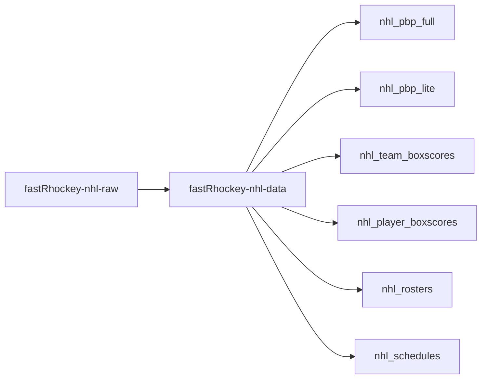
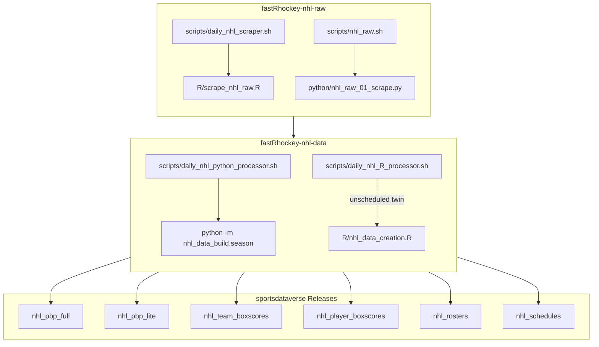

# fastRhockey-nhl-raw

Raw NHL game JSON data scraped from the NHL API via [fastRhockey](https://github.com/sportsdataverse/fastRhockey).



## fastRhockey NHL workflow diagram



## sportsdataverse-data releases

| Release tag | Content |
|-----|---------|
| [`nhl_pbp_full`](https://github.com/sportsdataverse/sportsdataverse-data/releases/tag/nhl_pbp_full) | NHL play-by-play data (full, includes shifts) |
| [`nhl_pbp_lite`](https://github.com/sportsdataverse/sportsdataverse-data/releases/tag/nhl_pbp_lite) | NHL play-by-play data (lite, no shift CHANGE events) |
| [`nhl_team_boxscores`](https://github.com/sportsdataverse/sportsdataverse-data/releases/tag/nhl_team_boxscores) | NHL team box scores |
| [`nhl_player_boxscores`](https://github.com/sportsdataverse/sportsdataverse-data/releases/tag/nhl_player_boxscores) | NHL player box scores (skaters + goalies) |
| [`nhl_rosters`](https://github.com/sportsdataverse/sportsdataverse-data/releases/tag/nhl_rosters) | NHL rosters |
| [`nhl_schedules`](https://github.com/sportsdataverse/sportsdataverse-data/releases/tag/nhl_schedules) | NHL schedules |

## Repository layout

<!-- BEGIN GENERATED: layout -->

```
fastRhockey-nhl-raw/
├── R/   # R pipeline stages and publish toolchain
│   └── scrape_nhl_raw.R
├── logs/   # per-run logs (gitignored where large)
├── nhl/
│   ├── json/
│   └── schedules/
├── python/   # Python pipeline stages, numbered in build order
│   ├── nhl_raw/
│   └── nhl_raw_01_scrape.py
├── scripts/   # bash drivers (the daily/weekly entry points)
│   ├── daily_nhl_scraper.sh
│   └── nhl_raw.sh
└── tests/   # test suite
    ├── fixtures/
    ├── test_assemble_parity.py
    ├── test_boxscore_parity.py
    ├── test_feed_parity.py
    └── test_scrape_parity.py
```

<!-- END GENERATED: layout -->

## Reports & explainers

<!-- BEGIN GENERATED: reports -->

| Report | What it is | Last updated |
|---|---|---|
| _none yet_ | — | — |

<!-- END GENERATED: reports -->

## Automation & status

<!-- BEGIN GENERATED: status -->

| workflow | schedule | last run |
|---|---|---|
| [](https://github.com/sportsdataverse/fastRhockey-nhl-raw/actions/workflows/fastRhockey_nhl_data_trigger.yml) | on push / dispatch | 2026-07-22 |
| [](https://github.com/sportsdataverse/fastRhockey-nhl-raw/actions/workflows/orphan_scripts.yml) | on push / PR / dispatch | 2026-08-19 |
| [](https://github.com/sportsdataverse/fastRhockey-nhl-raw/actions/workflows/scrape_nhl_raw.yml) | daily 08:00 UTC in Oct-Dec; daily 08:00 UTC in Jan-Apr; daily 08:00 UTC in May-Jun | 2026-07-18 |
| [](https://github.com/sportsdataverse/fastRhockey-nhl-raw/actions/workflows/tests.yml) | on push / PR / dispatch | 2026-08-19 |

<!-- END GENERATED: status -->
- **Scraping workflow** runs daily during the NHL season
- On push, triggers the [fastRhockey-nhl-data](https://github.com/sportsdataverse/fastRhockey-nhl-data) repo to compile datasets

## Pregame snapshots

Probable goalies and the league injury list are current-state feeds: once a game is played,
what was known before puck drop is gone. Stage 03 keeps it. Every 30 minutes from 15:00 to
03:00 UTC on NHL game days (October to June) it fetches the ESPN Site v2 scoreboard for the
ET game date and the league injury list, and keeps the capture only if a goalie, a goalie's
Expected / Confirmed status, or an injury status changed.

| Path | Content |
|---|---|
| `nhl/pregame/{END_YEAR}/{YYYY-MM-DD}.json` | `date`; `probed` (every probe time, UTC); `events` (ESPN event id, start time, both teams); `captures` (`captured_at`, `probables`, `injuries`), one per state change |

Droplet cron, with the 03:00 UTC run committing the day's file (a pregame commit does not
trigger the nhl-data season build; nhl-data compiles it on its daily run into the
`nhl_pregame_snapshots` release, one row per state with `valid_from` / `valid_to`):

```
*/30 15-23,0-2 * 10-12,1-6 * cd /mnt/sdv_repos/fastRhockey-nhl-raw && flock -n /tmp/nhl-pregame.lock bash scripts/nhl_pregame_snapshot.sh >> logs/nhl_pregame_snapshot.log 2>&1
0 3 * 10-12,1-6 *            cd /mnt/sdv_repos/fastRhockey-nhl-raw && flock -w 600 /tmp/nhl-pregame.lock bash scripts/nhl_pregame_snapshot.sh >> logs/nhl_pregame_snapshot.log 2>&1
```

Run one probe by hand with `bash scripts/nhl_pregame_snapshot.sh` (add `COMMIT=1` to commit),
and watch the cron with `tail -f logs/nhl_pregame_snapshot.log`.

## Related repositories

[fastRhockey-nhl-raw data repository (source: NHL API)](https://github.com/sportsdataverse/fastRhockey-nhl-raw)

[fastRhockey-nhl-data repository (source: NHL API)](https://github.com/sportsdataverse/fastRhockey-nhl-data)

[fastRhockey-pwhl-raw data repository (source: HockeyTech API)](https://github.com/sportsdataverse/fastRhockey-pwhl-raw)

[fastRhockey-pwhl-data repository (source: HockeyTech API)](https://github.com/sportsdataverse/fastRhockey-pwhl-data)

[fastRhockey-data legacy repository (archived; sources: NHL Stats API + PHF)](https://github.com/sportsdataverse/fastRhockey-data)

## Part of the [SportsDataverse](https://sportsdataverse.org/)

## Consumers

The packages that read what this repo produces:

- **R:** [fastRhockey](https://fastRhockey.sportsdataverse.org) — docs at <https://fastRhockey.sportsdataverse.org>
- **Python:** [`sportsdataverse.nhl`](https://github.com/sportsdataverse/sportsdataverse-py) — docs at <https://py.sportsdataverse.org>

## Stage inventory

Every numbered pipeline stage in `python/` (auto-listed; run subsets with the `scripts/*.sh` drivers by number or name):

- `python/nhl_raw_01_scrape.py`
- `python/nhl_raw_02_players_scrape.py`
- `python/nhl_raw_03_pregame_snapshot.py` (driver: `scripts/nhl_pregame_snapshot.sh`)
